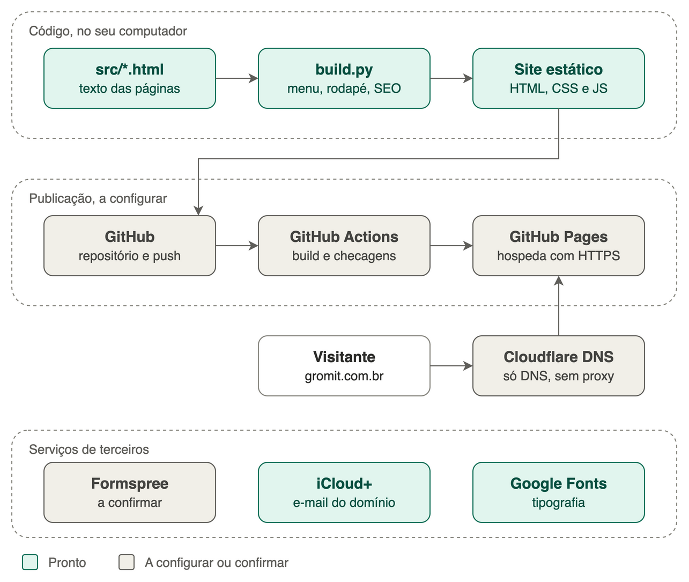
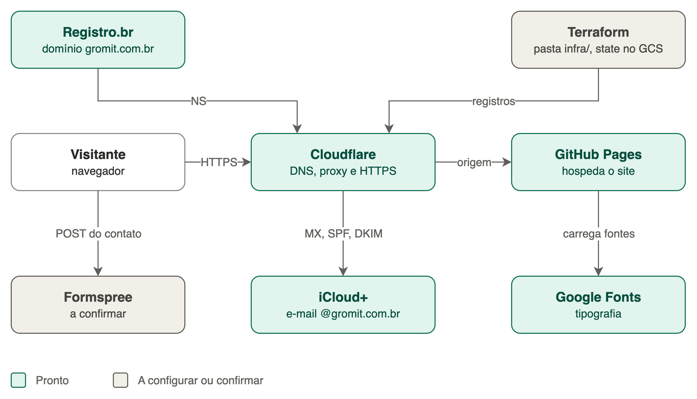
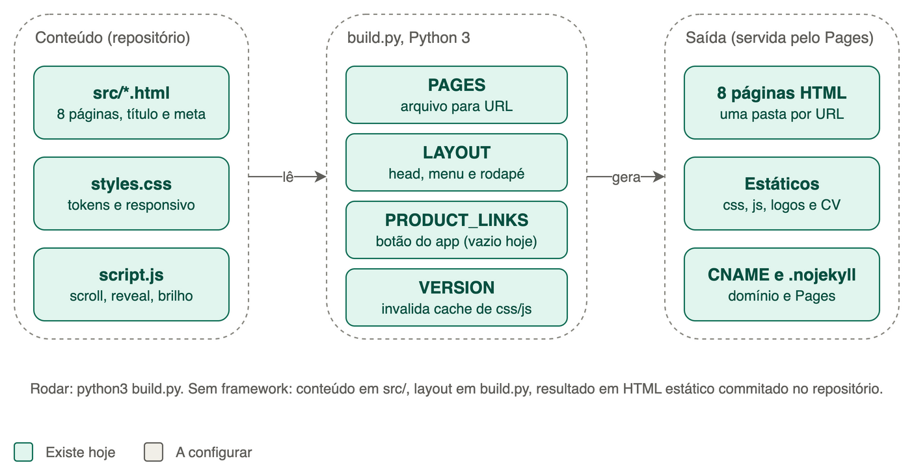
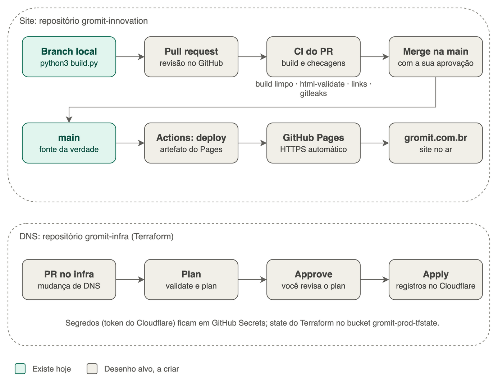

# Gromit Innovation: site institucional

Site estático da **Gromit Innovation** (consultoria em SRE, DevOps e Cloud), publicado em
[gromit.com.br](https://gromit.com.br). Sem framework e sem banco de dados: o conteúdo mora em
`frontend/src`, um build em Python gera o HTML e o resultado é servido pelo GitHub Pages.

> Estado atual: repositório **privado**, site **ainda não publicado**. Veja [Publicação](#publicação).

## Arquitetura

Os diagramas são arquivos [draw.io](https://www.drawio.com) editáveis, em [`docs/`](docs). Cada PNG tem o `.drawio` ao lado.

### Visão geral


### Infraestrutura e entrega
Domínio no Registro.br, DNS no Cloudflare (só DNS, sem proxy), hospedagem no GitHub Pages, e-mail no iCloud+.
Fonte: [`gromit-site-infra.drawio`](docs/gromit-site-infra.drawio)



### Dev e arquitetura do código
Fonte: [`gromit-site-dev-arquitetura.drawio`](docs/gromit-site-dev-arquitetura.drawio)



### CI/CD
Fonte: [`gromit-site-cicd.drawio`](docs/gromit-site-cicd.drawio). Em verde o que existe, em cinza o que falta ativar.



## Tecnologias

| Camada | Tecnologia | Uso |
|---|---|---|
| Front-end | HTML5, CSS3, JavaScript (sem framework) | Páginas, tema com custom properties, responsivo, `prefers-reduced-motion`, reveal com `IntersectionObserver` |
| Front-end | Google Fonts (Space Grotesk, JetBrains Mono) | Tipografia |
| Front-end | SVG | Favicon |
| Build e qualidade | Python 3.12, só biblioteca padrão | `build.py` gera o site; `check.py` valida conteúdo, links e SEO |
| Build e qualidade | Make, EditorConfig | Atalhos locais e estilo de código |
| CI/CD | GitHub Actions | Verificação em PR e deploy no Pages |
| CI/CD | Dependabot, CODEOWNERS | Atualização das Actions e do provider, revisor padrão |
| Hospedagem | GitHub Pages | Servidor estático com HTTPS automático |
| Infra como código | Terraform (>= 1.5) e provider Cloudflare (~> 5) | Registros DNS do site |
| Infra como código | Google Cloud Storage | State remoto e versionado (`gromit-prod-tfstate`) |
| Domínio e DNS | Registro.br, Cloudflare | Registro do domínio e zona DNS |
| E-mail | iCloud+ (domínio próprio) | Caixa `@gromit.com.br` |
| Formulário | Formspree | Envio do formulário de contato, sem servidor próprio |
| Documentação | draw.io | Diagramas versionados |

## Estrutura

```
.
├── frontend/              site
│   ├── src/               conteúdo: uma página .html por arquivo (título e descrição em comentário)
│   ├── public/            copiado como está para o dist: css, js, logos, favicon, CV, CNAME
│   ├── build.py           layout (head, menu, rodapé), sitemap e robots; gera frontend/dist
│   ├── check.py           verificações de conteúdo, links e SEO
│   └── dist/              saída do build (não versionada)
├── infra/                 Terraform: registros DNS do site no Cloudflare
├── docs/                  diagramas draw.io e PNG
├── .github/               workflows, dependabot e CODEOWNERS
├── Makefile
└── README.md
```

Não existe back-end de aplicação: o formulário usa o Formspree. Se um dia houver uma API (por exemplo,
formulário próprio), ela entra em uma pasta `backend/`, separada do front-end.

## Como rodar

Requisito: Python 3.12 ou superior.

```bash
make build     # gera frontend/dist
make check     # build + verificações (o mesmo que o CI roda)
make serve     # build + servidor local em http://localhost:8099
make clean     # remove frontend/dist
```

Para criar ou editar uma página, mexa em `frontend/src/`. A URL de cada arquivo está no dicionário
`PAGES` do `build.py`; menu e rodapé ficam em `LAYOUT` e `NAV`.

## Verificações (`frontend/check.py`)

O `check.py` falha o build se encontrar:

- página sem `lang`, `<title>`, meta description ou canonical absoluto, ou com título/descrição repetidos;
- link ou recurso interno inexistente, `` sem `alt`, `target="_blank"` sem `rel="noopener"`;
- página fora do `sitemap.xml`;
- **regras de conteúdo**: telefone, e-mail, link para repositório privado e **termos proibidos** (como nomes de
  empregadores atuais) no HTML. Os termos não ficam no repositório: vêm da variável `FORBIDDEN_TERMS` (no CI, variável do
  repositório) ou do arquivo local `frontend/.forbidden-terms`, ignorado pelo git (um termo por linha).

## CI/CD

- **CI (`.github/workflows/ci.yml`)**: em todo pull request, roda `build.py` e `check.py`.
- **Segurança**: no mesmo `ci.yml`, em runner do GitHub, rodam **Gitleaks** (segredos em todo o histórico),
  **Trivy** (vulnerabilidades, configuração e segredos) e **Semgrep** (análise estática). Imagens fixadas por versão;
  qualquer achado reprova o PR. Como usam runners do GitHub, é seguro para PRs vindos de forks.
- **Deploy (`.github/workflows/deploy.yml`)**: em push na `main`, gera o site e publica no GitHub Pages.
  Fica **desligado** até a variável de repositório `PAGES_ENABLED` valer `true`.
- Todas as Actions estão fixadas por SHA de commit, com permissões mínimas, `concurrency` e `timeout`.
- Segredos: nenhum no repositório. O token do Cloudflare, usado no Terraform, vive só em variável de ambiente.

## Publicação

O Pages gratuito exige repositório público. Antes de tornar público, confirme que o histórico não tem dados
pessoais (o CV atual já foi gerado sem telefone e e-mail).

1. Tornar o repositório público.
2. Settings > Pages > Source: **GitHub Actions**.
3. Settings > Secrets and variables > Actions > Variables: criar `PAGES_ENABLED` = `true`.
4. Aplicar o DNS (abaixo) e, em Settings > Pages, confirmar o domínio `gromit.com.br` e ativar **Enforce HTTPS**.

## Infra (DNS)

```bash
cd infra
export CLOUDFLARE_API_TOKEN=...        # token com permissão de edição de DNS na zona
cp terraform.tfvars.example terraform.tfvars   # preencher zone_id
terraform init
terraform plan
terraform apply
```

Os registros de e-mail do iCloud+ (MX, SPF, DKIM) já existem na zona e **não** são gerenciados por este Terraform.

## Convenções

- Commits em português, no formato `tipo: resumo` (`feat`, `fix`, `docs`, `ci`, `chore`).
- Mudanças entram por pull request; o `CODEOWNERS` pede revisão do responsável.
- O diretório `frontend/dist` nunca é commitado; o CI gera e publica.

## Segurança e privacidade

- Nenhum telefone, e-mail ou segredo em páginas públicas (garantido pelo `check.py`).
- Nenhuma menção a empregadores atuais; clientes citados só de experiências passadas.
- O formulário de contato envia os dados ao Formspree; o site não os armazena.

## Pendências

- Confirmar o formulário do Formspree e adicionar aviso de privacidade (LGPD).
- Definir a licença do repositório.
- Revisar datas e textos do CV e das páginas.
- Ativar o deploy no Pages e aplicar o DNS.
